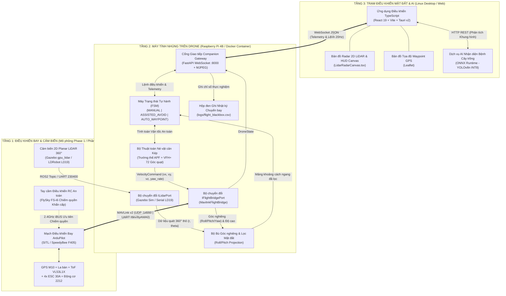
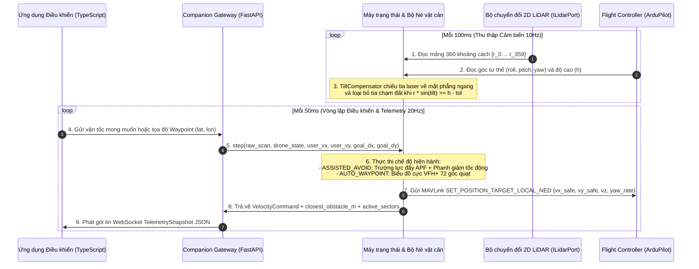
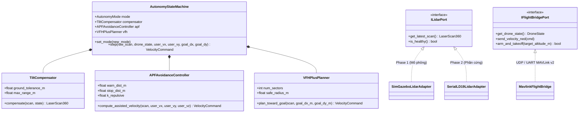

# uav-agri-autonomy

**Tiếng Việt** | [English](README-us.md)

**Nghiên cứu và phát triển hệ thống điều khiển và tự hành né tránh vật cản cho thiết bị bay không người lái (UAV) hướng tới ứng dụng giám sát nông nghiệp thông minh.**

*Research and Development of an Autonomous Obstacle Avoidance and Control System for Unmanned Aerial Vehicles (UAVs) Toward Smart Agriculture Monitoring.*

---

## 1. Tổng quan

`uav-agri-autonomy` là một monorepo nghiên cứu kéo dài trong hai học kỳ, triển khai Hệ thống Tự hành Phân cấp 3 Tầng (3-Tier Hierarchical Autonomy System) cho thiết bị bay Quadcopter hoạt động trong môi trường nông nghiệp bán cấu trúc (ruộng lúa, vườn chuối, vườn mai).

Hệ thống được thiết kế theo **Kiến trúc Lục giác (Hexagonal / Ports and Adapters Architecture)** nhằm đảm bảo toàn bộ tầng nghiệp vụ cốt lõi (`AutonomyStateMachine`, `TiltCompensator`, `APFAvoidanceController`, và `VFHPlusPlanner`) hoàn toàn độc lập với phần cứng qua cả hai giai đoạn:
- **Giai đoạn 1 (Niên luận cơ sở ngành — Mô phỏng):** Kiểm chứng toàn diện thuật toán và kiến trúc truyền thông trên **ArduPilot SITL + Gazebo Harmonic** qua giao thức UDP MAVLink (`udpin:0.0.0.0:14550`).
- **Giai đoạn 2 (Niên luận chuyên ngành — Phần cứng thực tế):** Triển khai trực tiếp lên máy tính nhúng **Raspberry Pi 4B** kết nối với mạch điều khiển bay **SpeedyBee F405 / Pixhawk** qua cổng UART (`921600 baud`) và cảm biến **2D Planar LiDAR $360^\circ$ (LDRobot LD19 / RPLIDAR A1)**.

### Danh mục Tài liệu
- [Yêu cầu Phần cứng, Bảng dự toán BOM & Ngăn xếp Công nghệ](docs/requirements/hardware.md)
- [Lộ trình Phát triển Giai đoạn 1 (Mô phỏng & Kiến trúc Phần mềm)](docs/dev/phases/phase_1.md)
- [Lộ trình Phát triển Giai đoạn 2 (Tích hợp Phần cứng Sim-to-Real)](docs/dev/phases/phase_2.md)
- [Sơ đồ Kiến trúc Tương tác Archify HTML](.archify/architecture-uav-agri-autonomy-20261105-214900/uav-agri-autonomy.html)

---

## 2. Kiến trúc Hệ thống Chi tiết

### 2.1. Kiến trúc Tự hành Phân cấp 3 Tầng (3-Tier Hierarchical Autonomy)



### 2.2. Chu trình Điều khiển Thời gian thực & Luồng Dữ liệu (Sequence Diagram)



### 2.3. Sơ đồ Lớp Kiến trúc Lục giác (Hexagonal Domain & Adapters)



---

## 3. Cấu trúc Thư mục (Repository Structure)

```text
uav-agri-autonomy/
├── README.md                               # Tài liệu chính (Tiếng Việt)
├── README-us.md                            # Tài liệu tiếng Anh (English)
├── docker-compose.sim.yml                  # Tổ hợp container SITL + Companion cho Phase 1
├── configs/
│   ├── simulation.yaml                     # Cấu hình Phase 1 (UDP :14550 + Gazebo LiDAR)
│   └── avoidance_params.yaml               # Tham số thuật toán APF, VFH+ và bù góc nghiêng
├── docs/
│   ├── requirements/
│   │   └── hardware.md                     # Tech Stack, dự toán BOM Phase 2 (<= 6M VNĐ), quy tắc đấu nối
│   └── dev/
│       └── phases/
│           ├── phase_1.md                  # Phân rã công việc Phase 1 (Mô phỏng & Kiến trúc - Đang triển khai)
│           └── phase_2.md                  # Phân rã công việc Phase 2 (Hướng phát triển Tích hợp Phần cứng)
├── drone-core/                             # Gói phần mềm tự hành trên Companion Computer (Python)
│   ├── pyproject.toml
│   ├── src/
│   │   ├── domain/                         # Nghiệp vụ cốt lõi thuần túy (Độc lập phần cứng)
│   │   │   ├── models.py                   # LaserScan360, DroneState, VelocityCommand
│   │   │   ├── tilt_compensator.py         # Chiếu góc Roll/Pitch & loại bỏ tia chạm đất
│   │   │   ├── apf_avoidance.py            # Mode 1: Bộ điều khiển Trường thế Nhân tạo (APF)
│   │   │   ├── vfh_planner.py              # Mode 2: Bộ hoạch định VFH+ 72 góc quạt
│   │   │   └── state_machine.py            # Chuyển đổi chế độ bay & tổng hợp lệnh an toàn
│   │   ├── ports/                          # Giao diện trừu tượng (Ports cho Phase 1 & Phase 2)
│   │   │   ├── lidar_port.py
│   │   │   └── flight_bridge_port.py
│   │   ├── adapters/                       # Các Adapter hiện hành cho Phase 1 (Simulation)
│   │   │   ├── mavlink_bridge.py
│   │   │   └── sim_lidar_adapter.py
│   │   ├── api/                            # Máy chủ FastAPI WebSocket & REST Gateway
│   │   │   └── server.py
│   │   └── logger/                         # Bộ ghi nhật ký hộp đen chuyến bay (.csv)
│   │       └── flight_logger.py
│   └── tests/                              # Kiểm thử đơn vị cho tầng Domain
│       └── test_avoidance_domain.py
├── crop-ai-service/                        # Mô-đun mở rộng: Nhận diện bệnh cây trồng (ONNX)
│   └── inference_onnx.py
├── ground-control-app/                     # Ứng dụng Trạm điều khiển Linux Desktop & Web (TypeScript)
│   ├── package.json
│   └── src/
│       ├── components/
│       │   └── LidarRadarCanvas.tsx        # Vẽ bản đồ Radar 360° & vector vận tốc trực quan
│       ├── hooks/
│       │   └── useDroneSocket.ts           # Hook kết nối WebSocket thời gian thực 20Hz
│       └── types/
│           └── protocol.ts                 # Định nghĩa cấu trúc gói tin đồng bộ với Backend
└── simulation-worlds/
    └── orchard_obstacles.sdf               # Môi trường vườn cây nhẹ trong Gazebo phục vụ kiểm thử
```

---

## 4. Hướng dẫn Khởi chạy & Định hướng Chuyển đổi Phase 2

### 4.1. Chạy Kiểm thử Đơn vị (Domain Unit Tests — Phase 1)
Các thuật toán né tránh vật cản cốt lõi (`TiltCompensator`, `APFAvoidanceController`, `VFHPlusPlanner`) không phụ thuộc vào thư viện phần cứng bên ngoài và có thể kiểm chứng trực tiếp bằng Python 3:

```bash
cd drone-core
PYTHONPATH=. python3 -c "import tests.test_avoidance_domain as t; t.test_tilt_compensation_rejects_ground_hit(); t.test_apf_repulses_forward_obstacle(); t.test_vfh_bypasses_front_obstacle(); print('ALL DOMAIN TESTS PASSED')"
```

### 4.2. Chạy Mô phỏng (Phase 1) và Hướng Mở rộng sang Phần cứng Thực tế (Phase 2)
- **Trọng tâm hiện tại — Chế độ Mô phỏng (Phase 1):** Hệ thống khởi chạy với tệp cấu hình `configs/simulation.yaml` (kết nối `udpin:0.0.0.0:14550` tới ArduPilot SITL và bộ chuyển đổi `SimGazeboLidarAdapter`).
- **Hướng phát triển — Chế độ Phần cứng Thực tế (Phase 2):** Nhờ giao diện trừu tượng `ILidarPort` và `IFlightBridgePort` đã định nghĩa sẵn, khi bước sang Học kỳ 2 chỉ cần bổ sung adapter phần cứng (`SerialLD19LidarAdapter` đọc cổng `/dev/ttyUSB0`) và đổi URI kết nối MAVLink sang cổng UART (`/dev/ttyAMA0` ở tốc độ `921600` baud) trên Raspberry Pi 4B mà không cần sửa đổi tầng `domain/`.
