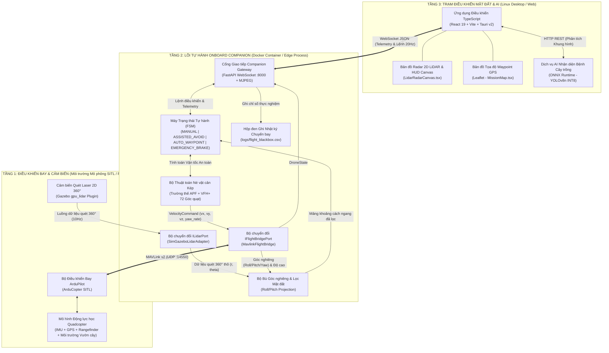
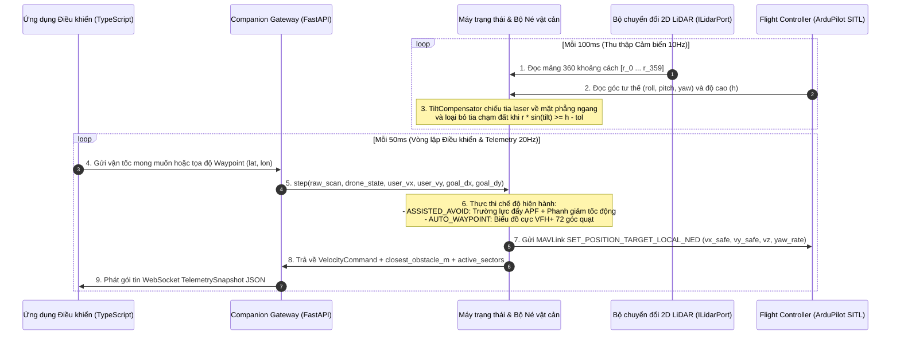
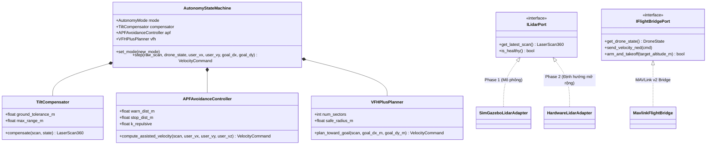

# uav-agri-autonomy

**Tiếng Việt** | [English](README-us.md)

**Nghiên cứu và phát triển hệ thống điều khiển và tự hành né tránh vật cản cho thiết bị bay không người lái (UAV) hướng tới ứng dụng giám sát nông nghiệp thông minh.**

*Research and Development of an Autonomous Obstacle Avoidance and Control System for Unmanned Aerial Vehicles (UAVs) Toward Smart Agriculture Monitoring.*

---

## 1. Tổng quan

`uav-agri-autonomy` là dự án nghiên cứu triển khai Hệ thống Tự hành Phân cấp 3 Tầng (3-Tier Hierarchical Autonomy System) cho thiết bị bay Quadcopter hoạt động trong môi trường nông nghiệp bán cấu trúc (ruộng lúa, vườn cây ăn trái, vườn cảnh).

Hệ thống được thiết kế theo **Kiến trúc Lục giác (Hexagonal / Ports and Adapters Architecture)** nhằm đảm bảo toàn bộ tầng nghiệp vụ cốt lõi (`AutonomyStateMachine`, `TiltCompensator`, `APFAvoidanceController`, và `VFHPlusPlanner`) hoàn toàn độc lập với môi trường thực thi:
- **Giai đoạn 1 (Trọng tâm hiện tại — Mô phỏng & Kiến trúc Phần mềm):** Nghiên cứu, xây dựng và kiểm chứng định lượng toàn bộ thuật toán né tránh vật cản cùng giao diện điều khiển trên môi trường mô phỏng vật lý (**ArduPilot SITL + Gazebo Harmonic**) qua giao thức UDP MAVLink (`udpin:0.0.0.0:14550`).
- **Giai đoạn 2 (Định hướng mở rộng — Tích hợp Phần cứng Thực tế):** Chuyển đổi hệ thống từ môi trường mô phỏng sang nguyên mẫu UAV vật lý thông qua việc gắn thêm các bộ chuyển đổi (Hardware Adapters) tương thích với giao diện trừu tượng sẵn có mà không cần viết lại tầng thuật toán cốt lõi.

### Danh mục Tài liệu
- [Đặc tả Yêu cầu Phần mềm & Tech Stack](docs/requirements/software.md)
- [Yêu cầu Phần cứng & BOM Dự kiến (Định hướng mở rộng)](docs/requirements/hardware.md)
- [Lộ trình Phát triển Giai đoạn 1 (Mô phỏng & Kiến trúc Phần mềm)](docs/dev/phases/phase_1.md)
- [Sơ đồ Kiến trúc Tương tác Archify — Phase 1 (Simulation)](architecture/phase/phase_1/phase_1.html)

---

## 2. Kiến trúc Hệ thống Chi tiết (Phase 1)

### 2.1. Kiến trúc Tự hành Phân cấp 3 Tầng (3-Tier Hierarchical Autonomy)



### 2.2. Chu trình Điều khiển Thời gian thực & Luồng Dữ liệu (Sequence Diagram)



### 2.3. Sơ đồ Lớp Kiến trúc Lục giác (Hexagonal Domain & Adapters)



---

## 3. Cấu trúc Thư mục (Repository Structure)

```text
uav-agri-autonomy/
├── README.md                               # Tài liệu tổng quan & thiết kế hệ thống (Tiếng Việt)
├── README-us.md                            # Tài liệu tổng quan & thiết kế hệ thống (Tiếng Anh)
├── docker-compose.sim.yml                  # Khởi chạy môi trường mô phỏng ArduPilot SITL + Companion Core
├── architecture/
│   └── phase/
│       └── phase_1/
│           └── phase_1.html                # Sơ đồ kiến trúc tương tác Archify cho Phase 1
├── configs/
│   ├── simulation.yaml                     # Cấu hình mô phỏng Phase 1 (UDP :14550 + Gazebo LiDAR)
│   └── avoidance_params.yaml               # Tham số thuật toán APF, VFH+ và bù góc nghiêng
├── docs/
│   ├── requirements/
│   │   ├── hardware.md                     # Đặc tả phần cứng dự kiến & Tech Stack
│   │   └── software.md                     # Đặc tả yêu cầu phần mềm, FR/NFR & Tech Stack
│   └── dev/
│       └── phases/
│           └── phase_1.md                  # Phân rã công việc & tiêu chí hoàn thành Phase 1
├── drone-core/                             # Gói phần mềm tự hành cốt lõi (Python)
│   ├── pyproject.toml
│   ├── scripts/
│   │   └── plot_blackbox_metrics.py        # Phân tích định lượng & xuất chỉ số từ flight_blackbox.csv
│   ├── src/
│   │   ├── config.py                       # Composition Root: Nạp YAML & tiêm phụ thuộc (DI)
│   │   ├── domain/                         # Nghiệp vụ cốt lõi thuần túy (Độc lập phần cứng)
│   │   │   ├── models.py                   # LaserScan360, DroneState, VelocityCommand
│   │   │   ├── tilt_compensator.py         # Chiếu góc Roll/Pitch & loại bỏ tia chạm đất
│   │   │   ├── apf_avoidance.py            # Mode 1: Bộ điều khiển Trường thế Nhân tạo (APF)
│   │   │   ├── vfh_planner.py              # Mode 2: Bộ hoạch định VFH+ 72 góc quạt
│   │   │   └── state_machine.py            # Chuyển đổi chế độ bay & tổng hợp lệnh an toàn
│   │   ├── ports/                          # Giao diện trừu tượng (Ports)
│   │   │   ├── lidar_port.py
│   │   │   └── flight_bridge_port.py
│   │   ├── adapters/                       # Các Adapter mô phỏng cho Phase 1
│   │   │   ├── mavlink_bridge.py
│   │   │   └── sim_lidar_adapter.py
│   │   ├── api/                            # Máy chủ FastAPI WebSocket & REST Gateway
│   │   │   └── server.py
│   │   └── logger/                         # Bộ ghi nhật ký hộp đen chuyến bay (.csv)
│   │       └── flight_logger.py
│   └── tests/                              # Kiểm thử đơn vị cho tầng Domain
│       └── test_avoidance_domain.py
├── crop-ai-service/                        # Mô-đun mở rộng: Nhận diện bệnh cây trồng (Edge AI / ONNX)
│   ├── models/
│   │   └── labels.json                     # Danh mục lớp bệnh lá cây & cấu hình ngưỡng NMS
│   └── inference_onnx.py                   # Pipeline tiền xử lý Letterbox, suy luận ONNX CPU & NMS
├── ground-control-app/                     # Ứng dụng Trạm điều khiển Linux Desktop & Web (TypeScript)
│   ├── package.json
│   └── src/
│       ├── components/
│       │   ├── LidarRadarCanvas.tsx        # Vẽ bản đồ Radar 360° & vector vận tốc trực quan
│       │   └── MissionMap.tsx              # Bản đồ tọa độ Waypoint GPS (Leaflet)
│       ├── hooks/
│       │   └── useDroneSocket.ts           # Hook kết nối WebSocket thời gian thực 20Hz
│       └── types/
│           └── protocol.ts                 # Định nghĩa cấu trúc gói tin đồng bộ với Backend
└── simulation-worlds/
    └── orchard_obstacles.sdf               # Môi trường vườn cây nhẹ trong Gazebo phục vụ kiểm thử
```

---

## 4. Hướng dẫn Khởi chạy & Định hướng Phát triển

### 4.1. Chạy Kiểm thử Đơn vị (Domain Unit Tests — Phase 1)
Các thuật toán né tránh vật cản cốt lõi (`TiltCompensator`, `APFAvoidanceController`, `VFHPlusPlanner`) không phụ thuộc vào thư viện ngoài và có thể kiểm chứng trực tiếp bằng Python 3:

```bash
cd drone-core
PYTHONPATH=. python3 -c "import tests.test_avoidance_domain as t; t.test_tilt_compensation_rejects_ground_hit(); t.test_apf_repulses_forward_obstacle(); t.test_vfh_bypasses_front_obstacle(); print('ALL DOMAIN TESTS PASSED')"
```

### 4.2. Trọng tâm Phase 1 và Hướng Mở rộng sang Phase 2
- **Giai đoạn 1 (Hiện tại):** Tập trung hoàn thiện và đánh giá thuật toán trên môi trường mô phỏng (`configs/simulation.yaml`) với bộ chuyển đổi `SimGazeboLidarAdapter` và kết nối MAVLink qua UDP.
- **Giai đoạn 2 (Định hướng tiếp theo):** Nhờ thiết kế tách biệt qua `ILidarPort` và `IFlightBridgePort`, toàn bộ phần lõi thuật toán và giao diện điều khiển từ Giai đoạn 1 được giữ nguyên khi mở rộng sang thử nghiệm trên hệ thống nhúng thực tế ở giai đoạn sau.
